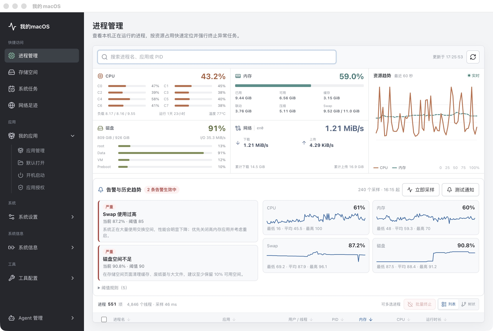
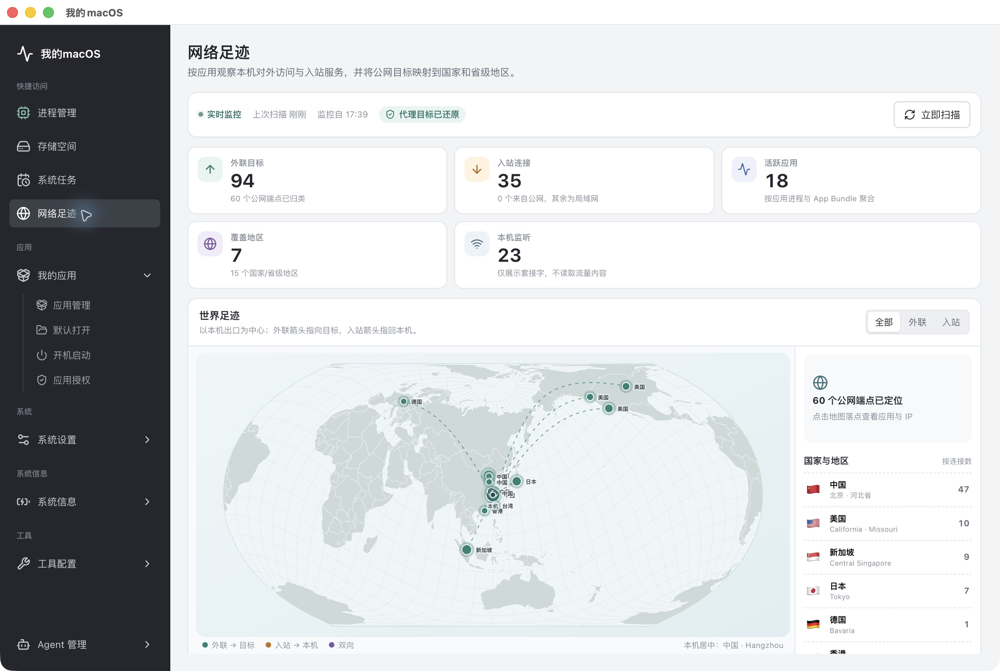
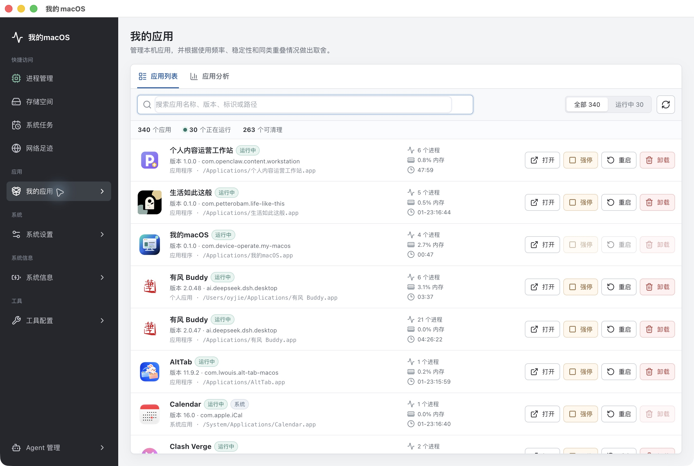
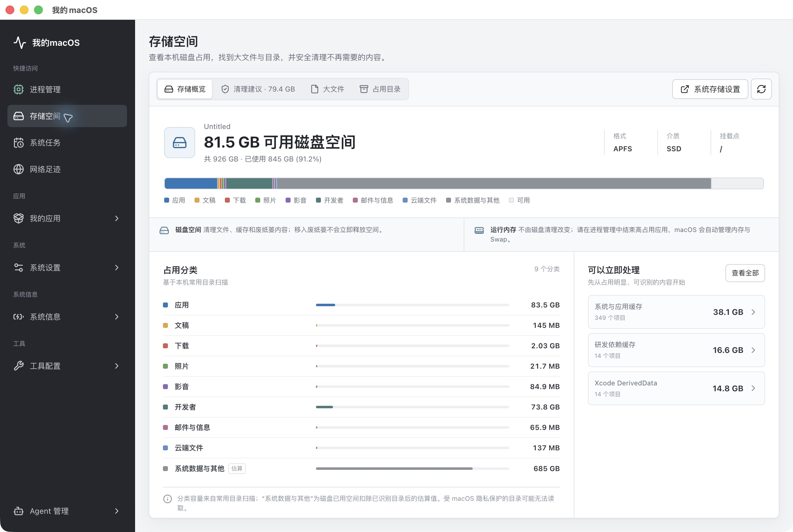
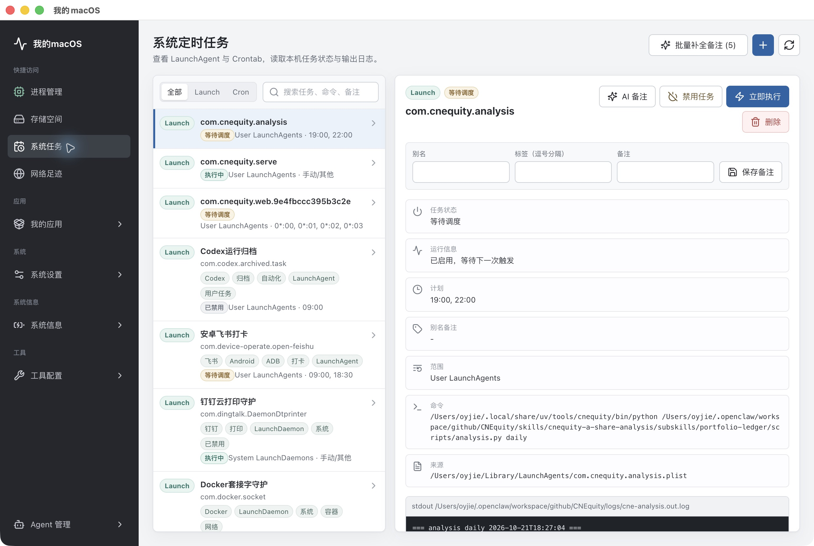

# 我的macOS · Device Operate

一个窗口管理你的 Mac：实时资源监控、应用治理、存储清理、网络足迹与系统定时任务。

[下载 macOS 版](https://github.com/petterobam/device-operate/releases/latest) · [产品介绍页](https://petterobam.github.io/device-operate/) · [查看界面截图](#界面)



## 功能

- 实时 CPU / 内存 / Swap / 磁盘 I/O / 网络 / 温度监控与阈值告警
- 应用清单、运行状态、资源占用、打开 / 重启 / 强停 / 卸载
- 存储分类、大文件、缓存清理与安全确认
- 按应用聚合的外联 / 入站 / 监听连接，世界地图与 Clash/Mihomo 代理透视
- LaunchAgent / LaunchDaemon / Crontab 统一管理与执行日志
- 真实 `~/.ssh` 管理、文件关联与应用授权
- 本地优先，不抓包、不上传系统数据

## 界面

| 网络足迹 | 我的应用 |
| --- | --- |
|  |  |

| 存储空间 | 系统定时任务 |
| --- | --- |
|  |  |

## 安装

1. 从 [Releases](https://github.com/petterobam/device-operate/releases/latest) 下载 `My-macOS-0.1.0-arm64.dmg`
2. 打开 DMG，把「我的macOS」拖入「应用程序」
3. 首次打开：已完成 Developer ID 签名与 Apple 公证，无需绕过 Gatekeeper
4. 按需授予完全磁盘访问 / 自动化权限，以启用应用授权、登录项等完整能力

要求：macOS 13+，Apple Silicon（arm64）。

---

# Device Operate

Local tools for operating the connected Android phone and monitoring macOS scheduled tasks.

## Feishu Android Command

Install the global command:

```bash
scripts/install_global_command.sh
```

Run the Feishu automation:

```bash
open-feishu-android
```

Run immediately without the configured random delay:

```bash
open-feishu-android --no-random
```

Other useful overrides:

```bash
open-feishu-android --close-delay 30
open-feishu-android --random-delay-min 0 --random-delay-max 1800
```

Local config lives at:

```bash
~/.config/device-operate/open-feishu.env
```

## Scheduled Task Monitor

Build, install, replace the existing `我的macOS.app` in `/Applications`, and launch it:

```bash
./install_app.sh
```

Start the local app:

```bash
npm run dev
```

Open:

```text
http://127.0.0.1:5173/
```

The app can:

- show native APFS capacity, available space, disk format, media type, and scanned storage categories
- surface cleanup targets for user caches, logs, Xcode data, device backups, old downloads, and Trash
- find large files with macOS Spotlight and rank large directories by measured or known minimum usage
- preview large files and directory contents, reveal them in Finder, and move individual items to Trash
- open the built-in macOS Storage settings for the complete system-managed category view
- list and search applications from the standard macOS application directories
- list macOS login items, add installed applications, and remove login items without uninstalling the app
- catalog application privacy permissions, read per-app TCC decisions when Full Disk Access is available, open the matching System Settings pane, and reset individual authorization records
- analyze applications by category, opening frequency, last use, 30-day usage time, and 90-day crash history
- group applications into high-frequency, review, removal, observation, and protected-system recommendations with explicit reasons
- show running application process counts, memory usage, and elapsed time
- open, force-stop, and restart applications
- uninstall non-system applications by moving them to the Trash
- initialize, inspect, copy, and regenerate local SSH keys without exposing private key contents until an explicit copy action
- parse and manage `~/.ssh/config` Host entries while preserving unrelated comments and directives
- group common file types by their current default application
- search file associations and change their macOS default application
- monitor per-application outbound and accepted inbound network connections, attribute public IPs to countries/regions, and visualize them on a local world map
- restore proxied destinations through a local Clash/Mihomo control socket when available, without capturing payloads
- list user and system LaunchAgent / LaunchDaemon tasks
- list user crontab tasks
- detect active Launchd and Cron executions, including PID and elapsed time (Cron uses exact command and cron-ancestor matching)
- show task details and output logs
- manually add user LaunchAgent tasks
- manually append user crontab tasks
- run a listed task immediately

The API runs on:

```text
http://127.0.0.1:4177/
```

Implementation scope and macOS permission boundaries are documented in [`docs/macos-application-management.md`](docs/macos-application-management.md).

## Agent Conversation, Alerts, System Info, Network and Backup

The app now covers five additional workstreams beyond process, storage,
application, SSH and task management.

### Agent conversation

- New **Agent 管理 > 对话** page: ask in plain language, the agent calls local
  tools and answers with the real values it read.
- The same tool catalog powers the page, the HTTP `/api/agent/tools` surface and
  the Claude Agent SDK harness. Tools are graded `read`, `write` and
  `destructive`; write and destructive tools only run after the matching
  permission level is selected in the chat header (stored in
  `~/.config/device-operate/agent.json`).
- When the Claude CLI/SDK is unavailable or its login expired, the server probes
  credentials (cached 30s), falls back to a deterministic local rules engine, and
  trips a 5 minute circuit breaker so a turn never blocks for minutes.

### Alerts, history and notifications

- Background sampler (30s) appends metrics to
  `~/.config/device-operate/metrics-history.jsonl` and evaluates five threshold
  rules: sustained CPU, memory pressure, swap usage, disk usage and CPU
  temperature.
- Fired alerts are delivered through macOS Notification Center (Electron
  `Notification` in the packaged app, `osascript` when only the API runs).
- **进程管理** shows an "告警与历史趋势" panel with active alerts, per-metric
  min/avg/max, sparklines, the rule list and "立即采样"/"测试通知" buttons.
- Electron now keeps a menu bar tray item showing `CPU% · 内存%`, active alerts
  and quick actions (open window, open monitor directory, quit).

### Battery, power, sleep log and software updates

- **系统信息 > 电池与电源**: charge, charging state, health percentage,
  condition, cycle count, serial number plus battery/AC power policy
  (`system_profiler SPPowerDataType`).
- **系统信息 > 睡眠唤醒**:最近 sleep/DarkWake/Wake events with reason, charge
  and duration, parsed from `pmset -g log`.
- **系统信息 > 软件更新**: current macOS version, available updates with sizes
  and restart requirements, auto-update preferences, plus a shortcut into
  System Settings. Results are cached for 30 minutes.

### Network diagnostics

- **系统信息 > 网络诊断**: ping with latency/loss statistics, traceroute hops,
  DNS lookups, TCP port checks, local listening ports with loopback/exposed
  classification, proxy configuration per network service and a Cloudflare
  download speed test.
- Every target is validated (`normalizeHost` / `normalizePort`) before it is
  passed to a command, so arbitrary input cannot reach the shell.

### Backup, config export and uninstall leftovers

- **系统信息 > 备份与导出**: Time Machine destinations, recent backups, session
  progress, APFS local snapshots (with per-snapshot delete) and configuration
  export/import covering task metadata, Agent permissions, the Feishu automation
  env file and `~/.ssh/config`. Credential-looking lines are redacted on export.
- **系统信息 > 卸载残留**: scans `~/Library` for reverse-DNS containers that no
  installed application claims (verified with Spotlight), reports their size and
  moves selected leftovers to the Trash. Removal is restricted to `~/Library`.

Verification for these features: `npm test` (96 tests), `npm run build`, and live
API checks against the local machine for every new endpoint.

## AI 对话（Pi 运行时）与手动 AI 配置

对话不再由 shell 出去的 harness 承担，而是嵌在本地服务里的 Pi 运行时：

```text
我的macOS（Electron 主进程 + 本地 Express 服务）
  └─ Pi 运行时（进程内嵌入 pi-agent-core）
       ├─ pi-ai      → 提供方抽象、凭证解析、token/成本统计
       ├─ tools      → fs / search / bash + 本机运维工具（按风险分级 + 权限确认）
       └─ HTTP       → /api/agent/chat 等接口把工具调用与结果推给界面
```

### 组成

- `server/agent/pi-runtime.js` —— pi-agent-core 的 `Agent` 循环 + pi-ai 的 `streamSimple` 作为 `streamFn`；
  工具桥把本仓库的工具目录（含 fs/搜索/bash）转成 pi 的 `AgentTool`；`beforeToolCall` 执行权限闸门；
  `message_end` 事件里累计 `usage`，并用 pi-ai 的价格表结算成本。
- `server/agent/ai-config.js` —— `~/.config/device-operate/ai.json`（权限 0600）。既是界面写入的配置，
  也是 pi-ai 的 `CredentialStore`（`read`/`list`/`modify`/`delete`）；支持环境变量兜底
  （`ANTHROPIC_API_KEY`、`OPENAI_API_KEY`、`GROQ_API_KEY` 等），环境变量不会被写回文件。
- `server/agent/ai-usage.js` —— `~/.config/device-operate/ai-usage.jsonl`，记录每轮 token 与成本，聚合成
  总量与按模型分组。
- `server/agent/system-tools.js` —— `read_file` / `list_directory` / `search_files` / `write_file` /
  `run_command`。路径必须在用户主目录或临时目录内，凭据类文件（`ai.json`、`~/.ssh/id_*`、钥匙串、
  `.aws/credentials`）一律拒绝；危险命令（`sudo`、`mkfs`、`rm -rf /`、`dd if=`、`curl | sh` 等）在执行前拦截。

### 手动配置菜单

`Agent 管理 > AI 配置`：

- 提供方列表来自 pi-ai 目录（约 41 个提供方、1600+ 模型），选中后按需拉取该提供方的模型列表。
- 填写 API Key 与可选 Base URL（自建或代理网关，会覆盖模型自带的 baseUrl）。
- 选择默认模型与思考等级；`检查凭证` 做离线校验，`实测连通` 会发送一次极小的真实请求。
- 展示累计 token 与成本；界面上只显示掩码，例如 `sk-ant…7890`。

对话页会显示当前运行时（`Pi · <模型>` 或 `Pi 未配置 · 本地规则`），并在每轮回答后附带 token 与成本。
未配置任何提供方时，对话自动降级为本地规则引擎，并在界面提示去 AI 配置。

### 任务备注也走 Pi

`generate-task-remark` 现在优先调用 Pi 的 `complete()`（无工具的 one-shot 补全）：读入内置 skill 与任务详情，
要求模型只输出 JSON，再解析成 alias/note/tags。未配置模型时回落到 Claude harness / 本地规则，并在
`warning` 里说明原因；该轮同样计入 token 与成本。

### 自定义提供方

AI 配置页可直接添加任意 OpenAI 兼容网关：填 ID、显示名、Base URL、Key、协议
（`openai-completions` / `openai-responses` / `anthropic-messages`）与模型 ID 列表。运行时会复用对应
内置提供方的传输实现，并把模型对象上的 `baseUrl` 指向网关。

### 接口

```text
GET    /api/ai/status                运行时状态 + 用量摘要
GET    /api/ai/providers             提供方与凭证状态（不含模型明细）
GET    /api/ai/models?provider=id    指定提供方的模型目录
GET    /api/ai/config                脱敏后的配置快照
PUT    /api/ai/config/provider/:id   写入 API Key / Base URL
DELETE /api/ai/config/provider/:id   清除凭证
PUT    /api/ai/config/custom         自定义 OpenAI 兼容提供方
PUT    /api/ai/config/default        设置默认提供方、模型、思考等级
POST   /api/ai/test                  凭证校验（live=true 时发一次真实请求）
GET    /api/ai/usage                 token 与成本聚合
POST   /api/agent/chat               对话（Pi 运行时；未配置时降级本地规则）
POST   /api/agent/chat/stream        流式对话（SSE）
DELETE /api/agent/chat/:sessionId    重置会话
```

## Network Footprint Monitor

See [docs/network-monitor.md](docs/network-monitor.md) for architecture, privacy boundaries, API routes and the follow-up roadmap.
